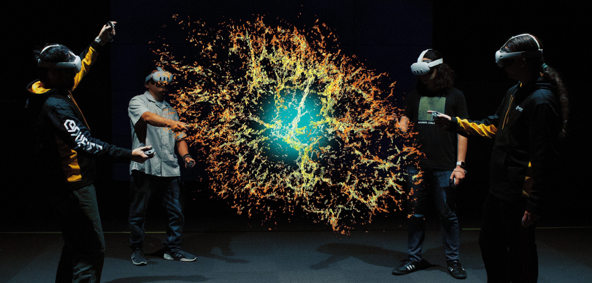
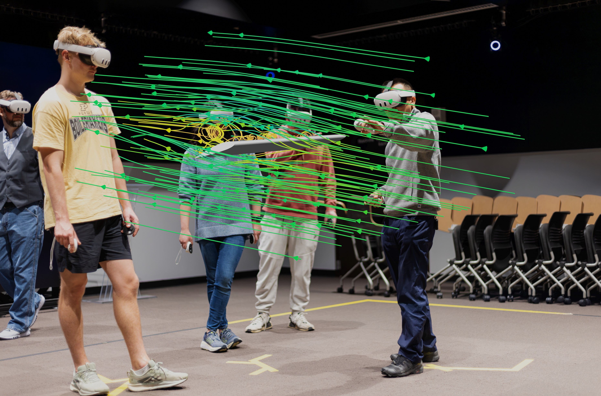

#  CollabXR

**CollabXR** is a shared immersive platform designed for collaborative learning, training, and research using interactive 3D content.

**[Documentation](https://envision-center.github.io/CollabXR-Documentation/) | [Website](https://envision.center/collabxr) | [Discord](https://discord.gg/MBwgJJwNmN) | [Collaborate With Us](https://purdue.ca1.qualtrics.com/jfe/form/SV_2b0p3gqYpaiVLGS)**

## Installation

We offer stable builds in the [Releases](https://github.com/Envision-Center/CollabXR/releases) tab for both Meta Quest (`.apk`) and Windows Desktop VR (`.zip`).
- Meta Quest: You can install the `.apk` onto your headset via the [Meta Quest Developer Hub](https://developers.meta.com/vr/downloads/package/oculus-developer-hub-win/).
- Desktop VR: Unzip the `.zip` file and run the executable. It will launch in whatever OpenXR runtime you have selected (i.e. [Meta Horizon Link](https://www.meta.com/en-gb/help/quest/1517439565442928/)).
- We do not have a published Meta Horizon Store application at this time.

You need a stable internet connection in order to use CollabXR.

### Classroom Setup

We cover how to set up your own classroom on the [documention](https://envision-center.github.io/CollabXR-Documentation/collab/setup.html).
We recommend reading the entire page, but here are some important bits.

1. [You'll need to print a QR code that you can scan](https://envision-center.github.io/CollabXR-Documentation/collab/setup.html#creating-your-own-room). It just needs to be a human-readable name so remote users can join, not a URL.
2. [Use that QR code to connect to a shared classroom](https://envision-center.github.io/CollabXR-Documentation/collab/setup.html#colocation-and-qr-codes). Multiple users can join the same class using that QR code.
3. [After evaluating, you will want to use your own Photon Fusion account](https://envision-center.github.io/CollabXR-Documentation/collab/setup.html#using-a-custom-app-id). This will give you a private network to minimize issues with concurrent user limits. Don't worry--Photon Fusion is free!
4. [Additional notes and best practices on co-location](https://envision-center.github.io/CollabXR-Documentation/collab/setup.html#colocation), in case your QR codes are acting weird.

## Modding

You can create content for use inside CollabXR by creating [mods](https://envision-center.github.io/CollabXR-Documentation/modding.html).
To get started with making content for use inside CollabXR, see the [preparing for mod creation](https://envision-center.github.io/CollabXR-Documentation/modding/setup.html) and [making a mod tutorials](https://envision-center.github.io/CollabXR-Documentation/modding/prefab.html).

- See the docs for [hosting your own mod repository](https://envision-center.github.io/CollabXR-Documentation/modpackager/modrepository.html).
- See the [CollabXR ModExtras documentation](https://envision-center.github.io/CollabXR-Documentation/modextras.html) for additional modding tools.

## Customizing

We are always looking for opportunities to improve CollabXR for the classroom. If you encounter a bug or need a modding feature you think we overlooked, please [submit an issue](https://github.com/Envision-Center/CollabXR/issues).

Need something more dedicated like a package or your own API keys? You can [build CollabXR yourself](https://envision-center.github.io/CollabXR-Documentation/collab/building.html).

## Contributing

If you would like to contribute to CollabXR directly, see the [Contributing guidelines](https://envision-center.github.io/CollabXR-Documentation/contribution.html).

